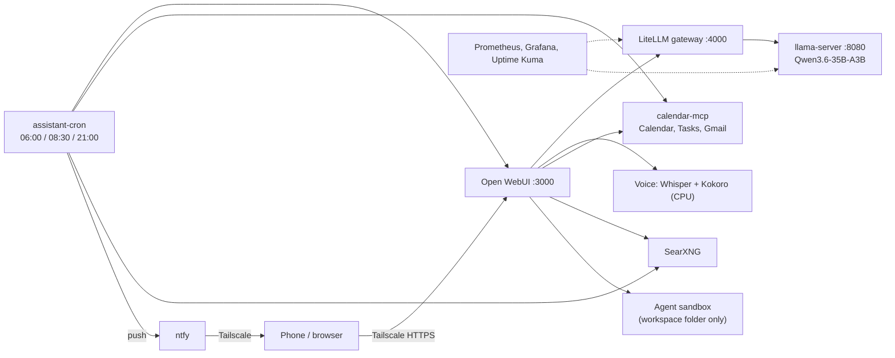

# Ultron

A private AI butler that runs on your own PC. No cloud AI: the model, your chats and your voice stay at home. Only the Google tools you connect talk to Google.

**One day with Ultron**

https://github.com/user-attachments/assets/4b208fee-5e24-454a-9a21-14254407f44d

Project page: [docs/index.html](docs/index.html) (also published with GitHub Pages at https://lcduc.github.io/ULTRON/).

## What it does

- **Chat with one local model.** Qwen3.6-35B-A3B (MoE, 3B active) with vision and MTP speculative decoding, about 55 tok/s on an RTX 3060 12 GB. It is loaded at startup and never swapped. A thinking mode and an agent mode use the same loaded model.
- **Butler persona.** Ultron answers as a polite butler in every chat.
- **Voice calls.** Hands-free talk with spoken answers, about 4.5 s from the end of your sentence to the first spoken reply. Speech-to-text (Whisper) and text-to-speech (Kokoro) run on the CPU, so they take no VRAM.
- **Google Calendar, Tasks and Gmail.** Read and add events, keep a to-do list, search and read mail, and draft replies. It cannot send or delete mail.
- **Phone briefings.** Three briefings arrive as pushes on your phone: 06:00 weather, 08:30 office (working days: schedule, news, markets) and 21:00 tomorrow. It is also saved as a chat, so you can reply to it.
- **Memory.** It remembers lasting facts you tell it, and a small profile is always in its prompt.
- **Web search.** Private search through SearXNG; no search account needed.
- **Agent sandbox.** `ultron-agent` runs shell commands in a locked-down container that sees only one workspace folder. Skills tell it how to use apps such as ComfyUI, and a planner keeps long tasks on track.
- **Monitoring.** Grafana (tokens, GPU, VRAM), Prometheus and Uptime Kuma, plus a daily backup.
- **Private by design.** Every service listens on localhost. Your phone or laptop reaches the chat over Tailscale, never the open internet.

## How it works

| Component | Address (this PC only) | Role |
|---|---|---|
| Open WebUI 0.13.3 | `localhost:3000` | Chat UI; the only thing published to Tailscale |
| llama.cpp (llama-server) | `127.0.0.1:8080` | Runs the model on the GPU, native on Windows |
| LiteLLM 1.109.1 | `localhost:4000` | Gateway, keys, token logs |
| calendar-mcp | internal | Calendar, Tasks and Gmail tools (MCP) |
| assistant-cron | internal | Builds the briefings |
| ntfy | `127.0.0.1:2586` | Phone pushes |
| SearXNG | internal | Web search |
| Kokoro | internal | Text-to-speech |
| Open Terminal | internal | Agent sandbox |
| Grafana / Prometheus / Uptime Kuma | `:3001` / `:9090` / `:3002` | Monitoring |

## Hardware and requirements

- Tested on: RTX 3060 12 GB, 32 GB RAM, Intel i5-14600KF, Windows 11.
- The model uses about 11.1-11.3 GB of VRAM and about 14 GB of RAM. Free system RAM with the full stack is about 3.4-3.9 GB.
- Software: Docker Desktop, Git, PowerShell, Python 3, Tailscale (for remote access), and a llama.cpp Windows CUDA 12 build unpacked in `bin\llama\`.
- Disk: the active model files (`models/`, not in git) are about 23.6 GB (22.7 GB model with MTP, 0.9 GB vision projector), plus any old models you keep.
- A Google account is optional; it is needed only for the calendar, tasks, mail and the briefing's schedule.

## Quick start

1. Clone the repo. Put the llama.cpp build in `bin\llama\` and the model files in `models\` (see Models below).
2. Run `scripts\gen-env.ps1`. It creates `compose\.env` with random secrets and the Prometheus secrets. It never prints them.
3. Run `scripts\start-all.ps1`. It starts Docker, the model server, the containers, the GPU broker and the Tailscale serve rules. A Windows task "Ultron Start" can run it at sign-in.
4. Open http://localhost:3000, create the admin account, and set the options listed under "Open WebUI settings" below.
5. Optional: connect Google (see Google Calendar), then the phone briefings (see Morning briefing).
6. Remote access: see Remote access (Tailscale).

# Reference

### What runs where

| Piece | Address (this PC only) | Notes |
|---|---|---|
| Chat UI (Open WebUI 0.13.3) | http://localhost:3000 | The only thing published to Tailscale |
| Model server (llama.cpp b12360) | 127.0.0.1:8080 | Native, GPU, API key required |
| Gateway (LiteLLM 1.109.1) | http://localhost:4000 | Token logs and keys; UI at `/ui`, log in with `LITELLM_MASTER_KEY` |
| Grafana | http://localhost:3001 | Dashboard "Ultron"; login is `GRAFANA_ADMIN_USER` / `GRAFANA_ADMIN_PASSWORD` |
| Prometheus | http://localhost:9090 | |
| Uptime Kuma | http://localhost:3002 | Create the admin and monitors on first visit |
| GPU exporter | 127.0.0.1:9835 | Native |
| Web search (SearXNG) | internal only | Used by the chat UI; no published port |
| Agent sandbox (Open Terminal 0.17.8) | internal only | Shell and files for `ultron-agent`; sees only the workspace folder |
| Voice (Kokoro-FastAPI 0.10.0, CPU) | internal only | The bot's spoken replies; Whisper speech-to-text runs inside Open WebUI |
| Phone pushes (ntfy 2.37.2) | 127.0.0.1:2586; tailnet `https://<pc-name>.<tailnet>.ts.net:8443` | Needs the user/token; carries the briefings to the iPhone |
| Briefing job (assistant-cron) | internal only | Sends the 06:00 weather briefing, the 08:30 office briefing (working days: schedule, news, markets) and the 21:00 evening preview; settings in `services/assistant-cron/config.yaml` |

All secrets are in `compose/.env` and `monitoring/secrets/` (git-ignored). This includes the Google Calendar refresh token, which the daily backup copies with the other secrets.

### Models

The model server runs in router mode (`scripts/models.ini`) with one preset, `ultron`. It loads at startup and is never swapped. The three names below all point to the same loaded model, so switching names does not reload anything (since 2026-11-22).

| Name in the picker | Model | Measured here |
|---|---|---|
| `ultron` | Qwen3.6-35B-A3B (MoE, 3B active), Q4_K_M with MTP, 49k context, thinking off | ~52–57 tok/s with MTP (44 without), ~11.1–11.3 GB of 12 GB VRAM, ~14 GB RAM, ~25–35 s to load |
| `ultron-think` | Same model with thinking on (temp 1.0, top-p 0.95) | Same speed; extra reasoning tokens per answer |
| `ultron-agent` | Same model, thinking off, presence penalty 0, 900 s timeout | Same speed; used with the terminal |

The model is `unsloth/Qwen3.6-35B-A3B-MTP-GGUF` (`models/Qwen3.6-35B-A3B-UD-Q4_K_M-MTP.gguf`, vision file `models/mmproj-Qwen3.6-35B-A3B-F16.gguf`). The preset uses `n-cpu-moe 28`, ubatch 1024 / batch 2048, MTP speculative decoding (`draft-mtp`, n-max 2) and the Qwen non-thinking samplers (temp 0.7, top-p 0.8, top-k 20, presence penalty 1.5). The per-name settings are in `compose/litellm-config.yaml`.

The old Gemma 12B and Qwen Heretic models are kept as dormant presets (`old-gemma-12b`, `old-qwen-heretic`). They load only when requested by name, and their files stay in `models/`. Stage logs: `logs/one-model-stage1.md`, `logs/one-model-stage2.md`.

Measured on 2026-11-22: time to first token for a one-line chat 0.33 s cached, 1.38 s uncached; voice model-to-first-sentence median 0.76 s; a cold 3k-token prompt takes 6-8 s; the agent test T4 passed in 5 rounds (~15 s). Memory-mapped loading was tried and rejected (44 tok/s, less free RAM).

Open items: free RAM with the full stack is slightly under the 4 GB target; the one-line chat prompt is 4,945 tokens with all tools (Qwen's tokenizer counts more than Gemma's); the briefing news section once returned "no results" (a search-side problem, not the model).

Test scripts: `scripts/test-tools.ps1`, `scripts/test-modes.ps1`, `scripts/test-refusals.ps1`, `scripts/bench-agent-model.ps1`.

### Cloud models (optional)

Three cloud models can be used next to the local ones, each with your own API key: `cloud-gpt` (OpenAI, `gpt-6.2-sol`), `cloud-claude` (Anthropic, `claude-sonnet-5-5`) and `cloud-gemini` (Google, `gemini-3-flash-preview`, which has a free tier). They go through the LiteLLM gateway like the local models.

1. Put the keys you have in `compose\.env`: `OPENAI_CLOUD_API_KEY`, `ANTHROPIC_API_KEY`, `GEMINI_API_KEY`. The OpenAI key has its own name, because `OPENAI_API_KEY` is the key for this stack's own gateway. Leave the others empty.
2. Run `docker compose -p ultron up -d litellm`, then `python scripts\allow-cloud-models.py` once (it lets the stack's gateway key use the three models; `--remove` undoes it).
3. Use them:
   - **Chat:** they appear in Open WebUI's model picker. A chat with one of them is sent to that provider; the `ultron` models stay fully local.
   - **Paper digest:** in `services\paper-digest\config.yaml`, set `writer_model` (who writes Deep reads and `/doc` rewrites) and/or `deep_chat_model` (who answers follow-ups in Deep-read chats) to `cloud-gemini`, `cloud-claude` or `cloud-gpt`. Only public paper text and your topic profile are sent. If a cloud call fails (no key, quota, outage), that step uses the local `ultron` instead and the audit log records it.

To use a different model of a provider, change its id in `compose\litellm-config.yaml` and run `docker compose -p ultron up -d litellm`.

### Agent sandbox

- The sandbox container can read and write only its own home volume and the workspace folder set by `AGENT_WORKSPACE` in `compose/.env`.
- It is on its own Docker network with Open WebUI only; it cannot reach the database, gateway or monitoring containers directly.
- It can reach the internet, and any service this PC publishes on localhost (model server, gateway, chat UI, Grafana, Uptime Kuma, Prometheus, GPU exporter). All but Prometheus and the GPU exporter require a key or login. Keep nothing private in the workspace.
- To connect it in Open WebUI: add an Open Terminal connection with URL `http://open-terminal:8000` and the `OPEN_TERMINAL_API_KEY` value from `compose/.env`, and enable it only for `ultron-agent` (web search stays on `ultron` and `ultron-think`).

### Skills and the GPU broker

- `skills/<app>/` holds an instruction file (`SKILL.md`) and helper scripts for each app the agent may operate. The folder is mounted read-only in the sandbox at `/home/user/workspace/skills/`.
- `skills/comfyui/comfy.py` runs ComfyUI workflow templates (`skills/comfyui/workflows/*.json`), saves results to the workspace `outputs/` folder, and validates parameters before queueing. It never installs anything into ComfyUI and never submits arbitrary graphs.
- `scripts/gpu-broker.ps1` (localhost port 8090, started by `start-all.ps1`) lets the helper unload the chat model before a ComfyUI job and free ComfyUI's VRAM after it. The chat model reloads by itself on the next request (~25–35 s). ComfyUI is no longer used since 2026-11-22; the broker still starts and the skill is kept.
- `scripts/model-idle.ps1` is retired (2026-11-22): `start-all.ps1` no longer starts it, because the model is never swapped. The script is kept. It used to swap the server back to `ultron` after `ultron-agent` had been idle for 5 minutes.
- ComfyUI must be running on port 8188 (ComfyUI Desktop → instance → Manage → Startup Args: `--port 8188`). It only serves while the Desktop app has the instance launched.
- To add a workflow: export it from ComfyUI with File → Export (API) and wrap it as described in `skills/comfyui/SKILL.md`.

#### Agent planning

`ultron-agent` has a short planning contract at the end of its system prompt (`scripts/agent-eval/contract.txt`, about 230 tokens, static between messages). Tasks of 1 or 2 steps are done directly, as before. Tasks of 3 or more steps start with a plan of at most 6 steps, each written as "do X || done when Y". The agent then runs one step at a time, checks the "done when" with a command, retries a failed step at most 2 times, replans at most 2 times per task, and ends with a report. It asks first before deleting files, starting a GPU job over 10 minutes, or installing anything outside the sandbox. A request that starts with "plan only" stops after the plan.

- `skills/planner/plan.py` keeps the plan in `workspace/tasks/<slug>/plan.json` (source of truth) and renders `PLAN.md` from it; the agent never edits the Markdown. Commands: `new <slug> --goal "..." --step "do X || done when Y" ...`, `show`, `start <n>`, `done <n> --note "..."`, `fail <n> --error "..."`, `replan --reason "..." --step "..."`, `report`. The last plan created is the default, so the slug is only given once. The third failure of a step prints `LIMIT: replan or stop`; a third replan prints `LIMIT: stop and report`. Tests: `docker exec ultron-open-terminal-1 python3 /home/user/workspace/skills/planner/tests/test_plan.py`.
- The tool-round cap is 40 for all models (Open WebUI 0.13.3 has no per-model cap).
- `python scripts/agent-eval/apply_contract.py` writes the contract into the Open WebUI database (after a timestamped copy); `--remove` goes back to pure ReAct. It does not touch the profile block that `scripts/apply-profile.py` puts after the date line.
- Rerun the comparison with `python scripts/agent-eval/run_eval.py` (needs ComfyUI running and about 3 hours; runs one job at a time and logs to `logs/agent-eval/<timestamp>.jsonl`). It drives `ultron-agent` through the gateway with the same terminal tools Open WebUI gives it (mode A without the contract, mode B with it) and checks the files each run leaves in the workspace. `--runs T1:A:1,T1:B:1` picks runs, `--summary` prints the table from all logs.

### Voice

You can talk to the bot and hear its answers. Both run on the CPU, on this PC, so they never take VRAM from the chat model and nothing leaves the machine.

- **Speech to text:** Whisper `small.en` inside the Open WebUI container (English only). It was measured at about 1.3 s for a 5-second sentence.
- **Text to speech:** the `kokoro` container, voice `am_michael`. It was measured at about 1 s per sentence and uses about 1 GB of RAM (capped at 3 GB).
- **How to use it:** in a chat, the **mic** button turns speech into text in the message box. The **headphones** button starts a hands-free call: talk, pause, and the bot answers out loud. Any reply can be read aloud with its speaker icon.
- **Voice-call instructions:** in a call, the bot follows `scripts/voice-prompt.txt`: one or two short sentences, no lists or symbols, numbers as digits. After editing the file, run `python scripts/apply-voice-prompt.py` (`--reset` goes back to Open WebUI's built-in prompt). Whisper's silence filter (`WHISPER_VAD_FILTER`) is on, so background noise is not transcribed as words.
- **Timing (measured 2026-11-21):** after you stop talking, the call waits a fixed 2 s for silence, then speech-to-text takes ~1 s (plus ~0.3–0.7 s to convert iPhone audio), the first sentence is ready ~0.6–1.2 s later and Kokoro speaks it after ~0.7 s. That is about 4.5 s in total. The first turn of a new chat takes a few seconds longer, because the model reads the ~3.7k-token tool list once.
- **Microphone access:** the browser allows the microphone only on `http://localhost:3000` or the Tailscale `https://` address, not on a plain `http://` LAN IP.
- **Changing the voice:** Admin Settings → Audio → TTS Voice. The voices that start with `af_`/`am_` are American female/male and `bf_`/`bm_` are British. Each user can also choose a voice under Settings → Audio.

The audio settings live in Open WebUI's database and override the `AUDIO_*` values in `compose/docker-compose.yml`. They were written straight into the database on 2026-11-21, and the old database was saved inside the container as `webui.db.bak-before-voice`.

### Google Calendar

`tools/google_calendar.py` is an Open WebUI tool. It lets the bot read your calendar and add, move or delete events with phone reminders ("I have a haircut at 1pm this Sunday, remind me"). The reminders are Google Calendar's own notifications, so they reach every phone signed in to the Google Calendar app.

**One-time setup**

1. In [Google Cloud Console](https://console.cloud.google.com/), create a project (e.g. "Ultron") and enable the **Google Calendar API**. For the MCP server below, also enable the **Google Tasks API** and the **Gmail API** (APIs & Services → Library).
2. **Google Auth Platform → Branding/Audience:** set up the consent screen. With a personal Gmail account, choose *External*, add yourself as a test user, then click **Publish app** so the status reads *In production*. Publishing needs a home page and privacy policy link under Branding: use https://lcduc.github.io/ULTRON/ and https://lcduc.github.io/ULTRON/privacy.html (served from `docs/`), with authorized domain `lcduc.github.io`. In *Testing* status, Google expires the saved access after 7 days. The app stays unverified, which is fine for your own use: at sign-in, click *Advanced → Go to Ultron (unsafe)*. With a company Google Workspace account, choose *Internal* instead; nothing expires, but your Workspace admin may have to allow it.
3. **Clients → Create client → Desktop app.** Download the JSON file.
4. On this PC, run `python scripts/google-auth.py <downloaded.json>`. Sign in, allow every permission Google lists (calendar, tasks and Gmail; only calendar is needed for the Open WebUI tool above, the rest is for the MCP server below), and the script writes `GOOGLE_CLIENT_ID`, `GOOGLE_CLIENT_SECRET` and `GOOGLE_REFRESH_TOKEN` into `compose/.env`. Delete the downloaded JSON afterwards.
5. `docker compose up -d open-webui` in `compose\` so the container picks up the new values.
6. Open WebUI → **Workspace → Tools → +**, paste `tools/google_calendar.py`, save with id `google_calendar`.
7. **Admin → Settings → Models**, edit `ultron`, `ultron-think` and `ultron-agent`, and tick *Google Calendar* under Tools so it is always on.

**How access is kept:** the refresh token in `compose/.env` lets the tool get a fresh one-hour access token whenever it needs one. You sign in again only if you revoke access at https://myaccount.google.com/permissions, the app is left in *Testing* status (7 days), or the token goes unused for 6 months. The tool then answers "Google sign-in failed"; rerun step 4 and 5.

**Limits on what it may do:** the token can only touch calendar events (scope `calendar.events`). Valves on the tool (Workspace → Tools → gear): calendar id, time zone override (default: the calendar's own), default length (60 min) and reminder (30 min). By default it can move or delete only events it created itself; set `ALLOW_CHANGING_OTHER_EVENTS` to change that. It refuses to add events in the past unless the user confirms, which catches wrong date arithmetic by the model.

**How the bot handles incomplete requests:** the instructions in the tool's docstrings tell the model to ask when the day or time is missing or vague, never to ask for an end time but to estimate a typical length (haircut 45 min, dinner 90 min, and so on), and to use all-day events for birthdays or trips. The tool backs this up in code, because a small model does not always follow instructions. It refuses a date without a time unless `all_day` is set, adds nothing when the same event is already there, and stops on a clash with another timed event until the user agrees to the overlap.

#### Paper digest: Google Drive

The paper digest (`services/paper-digest/`) saves its reports to your Google Drive. This needs one more permission, `drive.file`, which `scripts/google-auth.py` now asks for.

1. Enable the **Google Drive API** in Google Cloud Console (APIs & Services → Library).
2. Run `python scripts/google-auth.py <client.json>` once more and tick the Drive box on Google's permission screen. Then recreate the containers that read `compose/.env`.
3. Until you do, the digest still works; it just skips Drive and says so in its log.

Ultron sees only the files and folders it creates itself, nothing else in your Drive. It creates a folder called **Phase 9 — Ongoing** (with year, month and one folder per paper inside). You can drag that folder anywhere in your Drive; Ultron finds it again by name.

#### Google Calendar, Tasks and Gmail over MCP (trial)

`mcp/google-calendar/` is the same calendar tool rebuilt as an MCP server, to try MCP, and it now also covers Google Tasks and Gmail. It runs as the `calendar-mcp` container and reuses the Google credentials above. `google_auth.py` holds the shared sign-in, `calendar_api.py`, `tasks_api.py` and `gmail_api.py` hold the logic, and `server.py` publishes it as eleven MCP tools over Streamable HTTP at `http://calendar-mcp:8000/mcp`, behind a bearer key (`CALENDAR_MCP_API_KEY` in `compose/.env`). The container has no published port and is not on the agent network.

- **Calendar (5):** `calendar_today`, `list_events`, `add_event`, `update_event`, `delete_event`.
- **Tasks (3):** `tasks_list`, `tasks_add`, `tasks_update`. Tasks have a date at most; timed reminders belong in the calendar. "Remind me to call mom" with no day becomes a task in the list "To-do". Unknown list names are created on the first add, a duplicate open title is not added again, and a past due date is refused unless confirmed.
- **Mail (3):** `mail_search` (Gmail search syntax), `mail_read` (plain text, cut to about 4000 characters) and `mail_draft` (a reply or a new mail). There is no tool to send or delete mail: drafts are never sent, and you review and send them from Gmail. Email text is written by strangers, so `mail_read` wraps every body in "untrusted email content" markers and the tool descriptions tell the model not to follow instructions inside it.
- **Briefing job:** `Gmail.send_to_self` in `gmail_api.py` is for a later background job only. It is not an MCP tool, and it mails only the account's own address (looked up from the Gmail profile).
- **Prompt size:** the eleven tools' descriptions and schemas are about 11.6k characters, up from 6.8k for the five calendar tools. They are sent with every message.

**Scopes:** `scripts/google-auth.py` asks for `calendar.events`, `tasks`, `gmail.readonly`, `gmail.compose` and `gmail.send` in one sign-in, and checks that all of them were granted. The Gmail scopes are restricted: for an unverified app Google shows a warning screen, so click *Advanced → Go to Ultron (unsafe)* and tick every box. Also enable the **Google Tasks API** and the **Gmail API** in Google Cloud Console (APIs & Services → Library). A refresh token from an earlier sign-in has only the calendar scope: calendar keeps working, and the task and mail tools answer "Gmail/Tasks access is not granted yet" until you rerun `python scripts/google-auth.py <client.json>` and restart the container (`docker compose up -d calendar-mcp`).

**Tests:** `python -m unittest discover tests` in `mcp/google-calendar/` (needs `pip install -r requirements.txt`, ideally in a venv). The HTTP calls are faked, so it needs no network or credentials.

1. Add the key to `compose/.env` (once), then build and start the container: `docker compose up -d --build calendar-mcp` in `compose\`.
2. Open WebUI → **Admin Settings → External Tools → +**: type *MCP (Streamable HTTP)*, URL `http://calendar-mcp:8000/mcp`, auth *Bearer* with the key.
3. On each model, turn on the new MCP tool and turn off the old *Google Calendar* tool, so the model does not see the same tools twice.

### System status

`tools/system_status.py` is a read-only Open WebUI tool. Ask "How's the PC, Ultron?", "Is everything running?" or "GPU temperature?" and the butler answers from live figures: GPU temperature, load, VRAM and power, whether the model server is ready, the generation speed in tokens per second, and whether each service is up. Problems are listed first.

It only sends GET requests. The GPU and speed numbers come from Prometheus with the same queries as the Grafana dashboard, so they match it. The model server is checked through `/health` only, which never loads or swaps a model. Each service gets a quick probe (2 s limit, all at once) from inside the Open WebUI container. If Prometheus is down it still reports the probes. The speed is the 5-minute average, and "no recent requests" is reported when the model has been idle.

**Install:** Open WebUI → **Workspace → Tools → +**, paste `tools/system_status.py`, save with id `system_status`. Then **Admin → Settings → Models**, edit `ultron`, `ultron-think` and `ultron-agent` and tick *System Status* under Tools. The valves list the Prometheus and model-server addresses and the services to probe.

### Open WebUI settings made in the admin pages

Settings saved in the admin UI live in Open WebUI's database and override `.env` values. Record changes here so a rebuild can repeat them.

- Sign-ups disabled.
- Open Terminal connection to `http://open-terminal:8000` with the sandbox key; default terminal set on `ultron-agent` only.
- Function Calling set to Native on all three models.
- Web search (engine `searxng`, URL `http://searxng:8080/search`, 3 results) and code interpreter (Pyodide) enabled. These were written straight into the settings database on 2026-11-15 because the saved values overrode `.env`.
- External Tools: MCP (Streamable HTTP) connection `http://calendar-mcp:8000/mcp`, bearer key `CALENDAR_MCP_API_KEY`, attached to `ultron` and `ultron-think` only.
- Built-in Tools (per model, 2026-11-21): only *Time & Calculation* and *Web Search* on for `ultron` and `ultron-think`; only *Time & Calculation* on for `ultron-agent`. Each built-in tool's description is sent with every message, and with all of them on a one-line request was an 11k-token prompt (16 s) instead of 2k (2.5 s).
- Capabilities: Terminal off on `ultron` and `ultron-think` (Vision was off here until 2026-11-22; it is now on for all three, see below); Web Search and Code Interpreter off on `ultron-agent`, which keeps Terminal. Web search and the terminal stay on separate models. Memory is on for `ultron` and `ultron-think` (see 2026-11-21 below) and off for `ultron-agent`.
- Vision (2026-11-22): Vision capability turned on for `ultron`, `ultron-think` and `ultron-agent`, since the one model reads images (it read a receipt correctly).
- Audio (2026-11-21): STT engine local Whisper, model `small.en`; TTS engine OpenAI-compatible at `http://kokoro:8880/v1`, model `kokoro`, voice `am_michael`, split on punctuation.
- System prompts start with `Today is {{CURRENT_WEEKDAY}}, {{CURRENT_DATE}}.` Do not add `{{CURRENT_TIME}}`: it changes every minute and stops the model server from reusing the cached prompt.
- API keys (2026-11-21): `auth.enable_api_keys` turned on, so Settings → Account → API Keys appears. Admins can create a key without the per-user permission. The key is used by the chat-level tests and by `scripts/warm-voice.ps1`; save it as `ULTRON_API_KEY=` in `compose/.env`.
- Background tasks (2026-11-21): follow-up suggestions and tag generation turned off (Admin Settings → Interface); title generation stays on. Follow-ups ran after every reply: 3.5 s of GPU on `ultron`, 31–35 s on `ultron-think` (its reasoning is on). With one request at a time, the next message waits for them. Tags cost 1.3 s once per chat. Titles cost 0.7 s once per chat.
- Memory (2026-11-21): Memory capability and the Memory built-in tool turned on for `ultron` and `ultron-think` only. Automatic memory review (`memories.background_review.enable`) stays off. The Memory switch under Settings → Personalization is not set, so it follows the admin default (on).
- System prompts (2026-11-21): `ultron` and `ultron-think` end with a memory instruction (save a memory when the user says "remember…" or states a lasting fact, delete when asked to forget, search memory before saying "I don't know" about the user, never store passwords, card or ID numbers). All three prompts get the profile block from `scripts/apply-profile.py` after the date line.
- Agent planning (2026-11-21): the `ultron-agent` system prompt ends with a planning contract between `<!-- planning:start -->` and `<!-- planning:end -->`, written by `scripts/agent-eval/apply_contract.py` after a database copy (`webui.db.bak-<time>-planning`). It sits after the profile block. `CHAT_RESPONSE_MAX_TOOL_CALL_ITERATIONS` raised from 8 to 40 in `compose/docker-compose.yml` (Open WebUI 0.13.3 has no per-model setting; only its sub-agents set a cap per request), so it applies to all models.

#### Memory and profile

Two things give the bot what it knows about you. Both are plain text, and neither changes between messages, so the model server keeps reusing its cached prompt.

- **Profile (small, always sent):** copy `compose/profile.example.md` to `compose/profile.md` (git-ignored), fill in your name, city, languages, work, close people, routines and answer style, and keep it under 300 tokens. Then run `python scripts/apply-profile.py`. It saves a copy of the Open WebUI database, then writes the text between `<!-- profile:start -->` and `<!-- profile:end -->` after the date line in the `ultron`, `ultron-think` and `ultron-agent` prompts. Run it again after editing the file; `--remove` takes the block out. If `compose/profile.md` is missing it changes nothing.
- **Memories (grow over time):** the bot saves one when you say "remember…" or state a lasting fact about yourself, and searches them before saying it doesn't know something about you. To see, edit or delete them: Settings → Personalization → Memory → Manage. Memories belong to your account and stay in the Open WebUI database (so they are in the daily backup).
- **How they reach the model:** with the Memory switch on, each new message gets a hidden recall result placed after your message (not in the system prompt): all your "user" memories (up to 2000 characters) plus the 8 closest other memories to your last messages (up to 2000 characters). It is saved with the reply, so earlier turns are replayed unchanged. The memory tool's eight functions add about 1k tokens to every prompt (a one-line request was 2.9k tokens before, 4.0k after).
- `scripts/test-memory.ps1` checks recall (5 facts, a correction, a "forget"). It needs `ULTRON_API_KEY` and removes the memories it created. Known limitation (2026-11-22): it cannot pass as written. A bare `/api/chat/completions` call without a `chat_id` returns raw `tool_calls` and Open WebUI does not execute them. The script needs to create a chat first and pass `chat_id` and the assistant message id; `logs/one-model-tests/chatflow.py` shows the working flow. This is a test script issue, not a model issue: memory tools ran correctly in a real Open WebUI chat.

#### Measuring the assistant

`scripts\bench-assistant.ps1 -Label <name>` takes about 5 minutes and appends one JSON line to `logs\bench-assistant.jsonl`. It reads the real system prompts and tool schemas from Open WebUI and measures: prompt tokens and time to first token of a one-line request, what the background tasks cost in GPU seconds, voice speech-to-text and text-to-speech time, `test-tools.ps1`, and free RAM and VRAM. The chat-level tests (time to first token through Open WebUI, model-server requests per reply) need an API key from Settings → Account → API Keys, saved as `ULTRON_API_KEY=` in `compose/.env` or set as an environment variable; without it they print "ULTRON_API_KEY missing" and are skipped. `scripts\warm-voice.ps1` waits for Open WebUI and loads the Whisper model so the first voice message is fast (also needs the key; without it only the disk cache is warmed).

### Daily operation

- **Start everything:** `scripts\start-all.ps1` (also runs automatically at Windows sign-in, task "Ultron Start").
- **Stop containers:** `docker compose --profile gateway --profile monitoring --profile agent stop` in `compose\`.
- **Stop the model:** end the hidden PowerShell running `start-llama.ps1`, then `llama-server.exe`.
- **Docker fails with "file cannot be accessed by the system":** run `scripts\start-docker.ps1`; it moves the stale socket folders aside. Never use "Reset to factory defaults".
- **Model settings** (context size, model file): edit `scripts\start-llama.ps1`, then restart the model.

### Backups

- Task "Ultron Backup" runs `scripts\backup.ps1` daily at 03:00 and keeps 14 copies in `backups\`.
- Each backup holds the chat data, Grafana and Uptime Kuma data, the LiteLLM database dump, and the secrets.
- Copy `backups\` to another disk or cloud periodically; a backup on the same disk does not survive a disk failure.
- **Restore chat data:** stop the stack, then
  `docker run --rm -v ultron_open-webui-data:/data -v <backup folder>:/backup alpine:3.22 sh -c "rm -rf /data/* && tar xzf /backup/ultron_open-webui-data.tar.gz -C /data"`, then start again.

### Updating (monthly)

1. Read the release notes (Open WebUI has had serious security fixes this year).
2. Run a backup.
3. Change the pinned tag in `compose\docker-compose.yml`, then `docker compose --profile gateway --profile monitoring up -d`.
4. Send one chat message and check Grafana.

For llama.cpp, unpack a newer release over `bin\llama\` and re-check the flags in `start-llama.ps1` (flag names change between builds).

### Remote access (Tailscale)

1. Install Tailscale on this PC and sign in; install it on the phone/laptop with the same account.
2. In the Tailscale admin console, enable MagicDNS and HTTPS certificates.
3. Run `tailscale serve --bg 3000` once (also re-applied by `start-all.ps1`).
4. Open `https://<pc-name>.<tailnet>.ts.net` from any of your devices.

### Morning briefing and phone pushes

**What runs:** two containers in `compose\`. `ntfy` is the push server (user `ultron`, one private topic, everything else denied). `assistant-cron` is a small scheduler that sends three briefings, in the time zone set in `config.yaml`. Each is a push on the phone and a saved chat. Mail is in none of them.

| Time | Briefing | Contents |
|---|---|---|
| 06:00, every day | Morning | Greeting, today's weather and a clothing tip. One extra line only if something starts before 08:30. |
| 08:30, working days | Office | Push: counts of today's events and tasks (overdue ones separately) and the top story. Chat: today's list, up to 4 news stories with links, and a Markets table (gold, Bitcoin, S&P 500, VN-Index, USD, EUR). |
| 21:00, every day | Evening | Tomorrow's events and tasks in one list, and tomorrow's weather in one line with the clothing tip. |

The office briefing is skipped on weekends, on official Vietnamese public holidays (Google's "Holidays in Vietnam" calendar, events described as "Public holiday") and on days with an all-day event whose title contains Off, Leave, Nghỉ, OOO or Vacation (`day_off_keywords`). The skip is logged. If the holiday calendar cannot be read, the day counts as a normal one.

The `ultron` model is called once per briefing: a greeting and clothing tip for morning and evening; for the office briefing a greeting plus the picked and summarized news stories. Code writes everything else. Market numbers come only from code (CoinGecko, Yahoo Finance, Vietcombank, with backups); a row whose sources all fail is left out. News is searched through SearXNG (two topics, last 24 hours), the top articles are read, and stories reported in the last 3 days are skipped. If the model does not answer for 30 minutes, or answers badly twice, code uses fixed fallbacks: "Good morning, sir.", a clothing tip from simple weather rules, and the top 3 headlines with links.

- Push text is plain, at most 600 characters. UNAVAILABLE is the last line and names sections that failed, for example `UNAVAILABLE: News`.
- Each briefing is saved as an Open WebUI chat titled like `Briefing · Mon 23 Nov · office` (also `morning` and `evening`), kept `chat_retention_days` (7) days, in the Notifications folder. Tapping the push opens it, so you can reply. If the chat cannot be created, the push still goes out and opens a new Ultron chat. Other chats are never touched. The container needs `ULTRON_API_KEY` (from `compose/.env`).
- If a section fails, the briefing still goes out and names it on the UNAVAILABLE line.
- If ntfy fails, or `channel: email`, the briefing is emailed to your own Gmail address.
- Secrets (`NTFY_PASSWORD`, `NTFY_TOKEN`, `NTFY_TOPIC`) and the addresses (`ULTRON_PUBLIC_URL`, `NTFY_BASE_URL`) are in `compose/.env`; `scripts\gen-env.ps1` adds missing ones. `start-all.ps1` publishes ntfy with `tailscale serve --bg --https=8443 http://127.0.0.1:2586`; the chat UI stays on the root.
- A briefing missed while the PC was off is still sent up to `late_grace_hours` (4 h) late. Before sending, the job checks whether that day's briefing chat already exists, so restarting the container never sends a briefing twice. Dry runs with `--chat` title their chat `… · test`, so they never block the real one.

**Change times or sections:** edit `services/assistant-cron/config.yaml` (times, per-briefing sections on/off, `working_days`, `day_off_keywords`, `market_items`, `quiet_days`, city, `channel`, `model`, `limits`, `persona` for the greeting, `news_queries`, `chat_retention_days`), then run `docker compose up -d --force-recreate assistant-cron` in `compose\`. An empty time turns that briefing off.

**Test:** in `compose\`:

- `docker compose exec assistant-cron python briefing.py --run morning --dry-run` prints what it would send, with real data (it still calls the model; add `--no-model` to use the fallbacks). Add `--chat` to also create the briefing chat, `--show-chat` to print its text and `--raw` to print the section data.
- `docker compose exec assistant-cron python briefing.py --fixture fixtures/office-weekday.json --dry-run` tests the layout with fake data and fetches nothing. Fixtures (in `fixtures/`): `office-weekday`, `office-weekend`, `office-holiday`, `office-leave`, `office-overdue`, `office-empty`, `office-news-failed`, `office-markets-partial`, `office-first-day-fx`, `morning-early`, `morning-no-early`, `evening-busy`, `evening-clear`, `evening-many` (8+ items, shows "and N more"), `evening-symbols` (symbols, emoji and a URL in titles). `--now 2026-11-24T09:00` fakes the clock; `--run office` is a third mode next to morning and evening. A fixture run never sends and never creates a chat unless you add `--chat`.
- `docker compose exec assistant-cron python briefing.py --run evening` sends one for real (push and chat).

**Spoken evening briefing.** The 21:00 push also carries a 15-30 second MP3 in Ultron's voice (Kokoro, voice `am_michael`): greeting, tomorrow's schedule (at most 6 items, then "and N more"), tomorrow's weather and the same clothing tip as the text. Code writes the script; the model is not involved. If Kokoro is down, the normal text push goes out alone. The clip is saved on the state volume and served at `https://<your-host>.ts.net:8445/voice/evening.mp3` (tailnet only) with `Authorization: Bearer <VOICE_KEY>` (the key is in `compose/.env`); only today's clip is served, otherwise 404. By default the push stays text only; `spoken.attach_to_push: true` also attaches the MP3. iPhone Shortcut: Automation, New, Time of Day 21:05, Daily, Run Immediately, notifications off; actions (1) Set Silent Mode Off, (2) Set Volume (e.g. 60%), (3) Get Contents of URL (the URL above, Method GET, header `Authorization` = `Bearer <key>`), (4) Play Sound with Contents of URL as input, (5) Set Silent Mode On (skip if you keep silent mode off). Play Sound is muted in silent mode, hence steps 1 and 5 (Set Silent Mode needs iOS 17 and an Action-button iPhone). Needs Tailscale on; if the clip is not ready (404) the shortcut just fails. Switch it off with `spoken.enabled: false` in `config.yaml` (text only, as before). Preview: `docker compose exec assistant-cron python briefing.py --run evening --dry-run --fixture fixtures/evening-many.json` prints the SPOKEN script with its word count and writes the MP3 under `/tmp` in the container (`--no-audio` prints the script only). ntfy attachments are now on (`compose/ntfy/server.yml`): files up to 5 MB, 100 MB in total, deleted after 24 hours. Recreate both `ntfy` and `assistant-cron` after changing them.
- `docker compose logs assistant-cron` shows one line per section and how it was sent.
- Check delivery on the server: `curl -H "Authorization: Bearer <NTFY_TOKEN>" "https://<pc-name>.<tailnet>.ts.net:8443/<NTFY_TOPIC>/json?poll=1&since=10m"`.

**Rain alerts:** one push, no chat, when rain is about to start: "Rain expected in about 30 minutes, sir. Take the umbrella if you're heading out." (within 10 minutes it says "within minutes"). Off by default.

- Every `check_minutes` (15) the job reads Open-Meteo for the city: the current reading, the 15-minute forecast and the hourly rain chance. (Outside Europe and North America the 15-minute values are interpolated from hourly data.) Code decides, no model.
- It alerts only if it is dry now (under 0.1 mm and no rain weather code) and the first 15-minute slot within `lookahead_minutes` (60) has rain (0.1 mm or more, or a rain weather code) with an hourly rain chance of at least `reminders.rain_threshold` (40 %). Missing chance data counts as enough.
- At most one alert per `cooldown_hours` (3). A time-to-leave reminder that warned about rain counts as an alert. Nothing between `quiet_start` and `quiet_end` (22:00-06:00).
- If the rain starts inside the rain window already named in today's morning briefing, it stays quiet. Rain before or after that window still alerts.
- The last alert time is in `/app/state/rain.json` (`RAIN_STATE`) and is saved before sending. If that file cannot be read or written, nothing is sent.
- Switch on: set `rain_alerts: enabled: true` in `config.yaml`, then `docker compose up -d --force-recreate assistant-cron` in `compose\`.
- Test: `docker compose exec assistant-cron python briefing.py --rain --dry-run` (real forecast) or `--rain --dry-run --fixture fixtures/rain-soon.json --now 2026-11-24T14:20`. It prints PUSH, ONSET and REASON, sends nothing and uses a temp state file. Fixtures: `rain-soon`, `rain-already`, `rain-none`, `rain-low-probability`, `rain-quiet` (use `--now 2026-11-24T23:00`), `rain-in-morning-window`, `rain-before-morning-window` (the fixture's `morning_window` stands in for the briefing state) and `rain-cooldown` (needs a pre-seeded state: `--state /tmp/s.json` after `echo '{"last_alert": <unix time up to 3 h before --now>}' > /tmp/s.json` inside the container).

**iPhone setup:**

1. Install the ntfy app from the App Store.
2. Settings, Default server: `https://<pc-name>.<tailnet>.ts.net:8443` (the `NTFY_BASE_URL` value).
3. Settings, Users: add that server with user `ultron` and the `NTFY_PASSWORD` value (the app also accepts the `NTFY_TOKEN` as an access token).
4. Subscribe to the topic (`NTFY_TOPIC`), using the default server. Allow notifications when iOS asks.
5. In the Tailscale app, turn on VPN On Demand, so the phone can reach this PC when a push arrives (Apple's relay only wakes the app; the text is fetched from this PC over Tailscale).

### Paper digest (research papers, nightly)

**What runs:** the `paper-digest` container (`services/paper-digest/`, plan in `logs/plans/paper-digest.md`). Every night at 01:00 it collects new papers (arXiv: cs.RO, cs.CL, cs.LG, cs.AI, cs.CV, cs.IR, cs.MA, cs.SD, eess.AS, eess.SY; Hugging Face Daily Papers; Semantic Scholar), scores them for GenAI and robotics, and writes three levels of report:

| Level | What you get | Where |
|---|---|---|
| Deep read | Full A–M tutor report; only for papers that change the foundations | Its own chat, "Paper · <title>", with the paper's text loaded for follow-ups |
| Overview | About one page (A, B, C, D, G, H, J, L) | The digest chat, "Papers · <date>" |
| Brief | One or two lines and the link | The digest chat |

All chats are in the **Papers** folder. A push arrives at 09:00. Settings (topics, weights, budget, times, models) are in `services/paper-digest/config.yaml`; prompts in `services/paper-digest/prompts/`.

**Replies in the digest chat:** `deep 3` gives paper 3 a Deep read (straight away when the GPU is free). `3 skip`, `5 overview`, `7 brief` correct the scoring; the next nights learn from them.

**In a Deep-read chat:** ask anything, or use `/eli5`, `/visual`, `/deep`, `/code`, `/compare`, `/quiz`, `/defend`. `/doc` saves the full report, updated with the follow-ups, as a Google Doc in Drive (see "Paper digest: Google Drive" above).

**Your own paper:** paste an arXiv or PDF link into any Ultron chat and ask Ultron to read it (tool `paper_reader`). Setup, once: run `scripts\gen-env.ps1` (it adds a random `PAPER_QUEUE_KEY` to `compose\.env` and changes nothing else that is set), recreate the container (`docker compose -p ultron up -d paper-digest`), then run `python scripts/install-paper-tool.py`.

**By hand:** `docker compose -p ultron exec paper-digest python digest.py --run-now [--dry-run] [--no-push] [--no-deep] [--limit N]`. Audit logs of every step: the `paper-state` volume, `audit/`.
